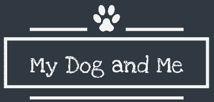

# My Dog & Me

> A full-stack React app with a dog theme — uses browser geolocation and Google Maps to put you (and your dog) on the map.




A two-part app: a Create-React-App frontend that detects the user's current location and renders an interactive Google Map, paired with an Express/Pug backend.

## Features

- **Geolocation** — `CurrentLocation` component reads the browser's position
- **Interactive map** — `Mapcontainer` renders a Google Map centered on the user
- **Navigation** — themed `Navbar` and banner imagery
- **Express + Pug backend** — separate `server/` app for API/routes

## Tech stack

React (Create React App) · Google Maps JavaScript API · Express · Pug

## Run locally

```bash
git clone https://github.com/aaaronmiller/mydogandme.git
cd mydogandme

# frontend
npm install && npm start          # http://localhost:3000

# backend (separate terminal)
cd server && npm install && npm start
```

## Structure

```
src/                 # React frontend
  Components/         # CurrentLocation, Mapcontainer, Navbar
server/              # Express + Pug backend
```
